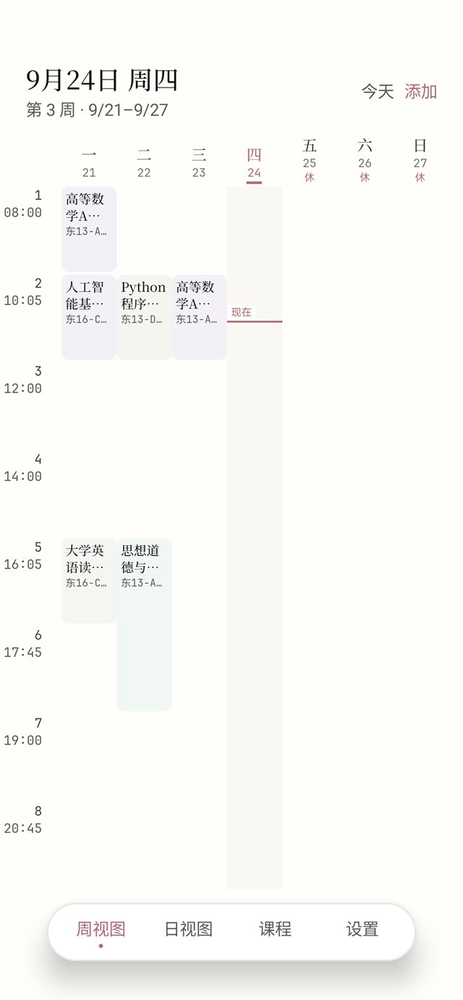
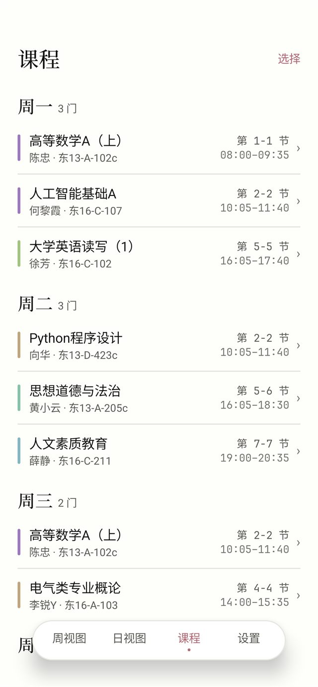
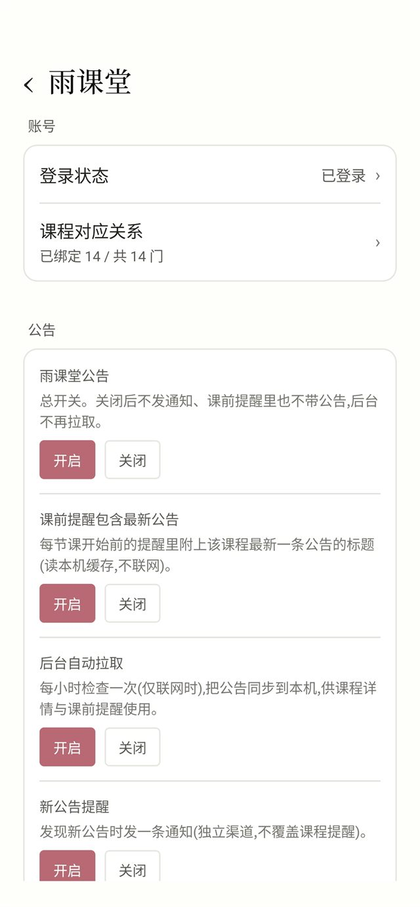
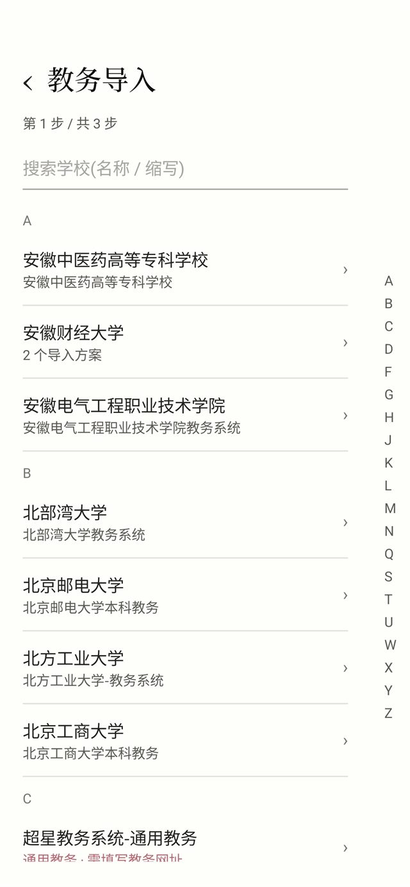

<div align="center">

# 余课 · Yohaku

<p align="center">
  <strong>「该留白的地方，就留白。」</strong><br/>
  为中国大学生量身打造的极简 Android 课程表 · 纸感设计 · AI 自然语言助手 · 灵动胶囊 · 深度雨课堂联动
</p>

<p align="center">
  <a href="https://classtable.kspace.eu.org"><strong>🌐 访问官网</strong></a> &nbsp;&bull;&nbsp;
  <a href="https://github.com/kuailiaojie/classtable/releases"><strong>🚀 立即下载</strong></a> &nbsp;&bull;&nbsp;
  <a href="#-核心特性"><strong>✨ 核心特性</strong></a> &nbsp;&bull;&nbsp;
  <a href="#-界面预览"><strong>📸 界面预览</strong></a> &nbsp;&bull;&nbsp;
  <a href="docs/architecture.md"><strong>📖 架构文档</strong></a>
</p>

<p align="center">
  
  
  
  
  
  
  
  
</p>

</div>

---

> 课表 App 大多喜欢把功能堆在脸上 —— 开屏广告、花哨签到、社交广场与横向滚动的繁复时间轴。<br/>
> 这也是「**余课**」名字的来头：**该留白的地方，就留白。**
> 
> 打开就是一整周 —— 横看七天、竖看节次，一屏看尽无需反复翻页；<br/>
> 四维全能导入，课前提醒准点却绝不喧扰；<br/>
> 界面只留必要之物：一抹东方和色、三档纸面中性，其余尽付与白。

---

## ✨ 核心特性

<table>
  <tr>
    <td width="50%" valign="top">
      <h3>🌸 东方余白（Yohaku）美学</h3>
      <p>把课表当纸看，不把界面当装饰。全局仅设一个强调色（梅 / 縹 / 若竹 / 朽葉 / 蘇芳 / 空色 六和色可选），三档深浅纸面色板，搭配衬线宋体排版，呼吸感自然流淌。</p>
    </td>
    <td width="50%" valign="top">
      <h3>✦ AI 智能课表助手</h3>
      <p>一句话完成查课、调课、查空堂、记偏好与建日程。支持 Gemini、DeepSeek、通义千问等全系主流大模型。遵循「先查再改」与本地自检原则，绝不让幻觉污染课表。</p>
    </td>
  </tr>
  <tr>
    <td width="50%" valign="top">
      <h3>⏱️ 灵动胶囊与实时活动</h3>
      <p>课前提醒优雅升级。原生支持国产主流机型状态栏胶囊（灵动胶囊/超级岛/实况通知）与锁屏实时活动，按分钟动态推进「距上课 → 上课中 → 距下课」，单条原地更新零打扰。</p>
    </td>
    <td width="50%" valign="top">
      <h3>📅 全景周视图 & 沉浸日视图</h3>
      <p>周视图横看七天、竖看节次，标有今日时间线与气温看板；日视图卡片流转、每 30 秒倒数下课与下一节课，空堂时长一目了然。</p>
    </td>
  </tr>
  <tr>
    <td width="50%" valign="top">
      <h3>📝 日程分轨与考试倒计时</h3>
      <p>日程与倒计时清晰双轨：<b>日程</b>收待办与活动，铺就日历周条与全天时间线；<b>倒计时</b>收考试与作业，按剩余天数精准倒数，到点提醒不错过。</p>
    </td>
    <td width="50%" valign="top">
      <h3>📥 四维全能课表导入</h3>
      <p>全国主流高校教务系统一键同步、表格与 Excel 极速导入、AI 课表截图视觉识别，以及精细的手动录入。单双周、自定义周次全自动归类。</p>
    </td>
  </tr>
  <tr>
    <td width="50%" valign="top">
      <h3>🔔 深度雨课堂联动</h3>
      <p>登录雨课堂后自动关联班级，课程详情页展示完整公告时间轴，课前提醒智能附带最新课堂通知，告别错过随堂测验与作业。</p>
    </td>
    <td width="50%" valign="top">
      <h3>🔒 纯粹私密，设备优先</h3>
      <p><b>零广告、零促销、零第三方追踪 SDK</b>。课表默认全量保存在本机，不注册亦能完美使用；换机时可选安全云同步，删改实时双向同步。</p>
    </td>
  </tr>
</table>

---

## 📸 界面预览

<div align="center">

| 周视图（七天全览） | 课程（星期分组） | 雨课堂（公告联动） | 教务系统（一键导入） |
| :---: | :---: | :---: | :---: |
|  |  |  |  |
| *一屏收尽整周，时间线流淌* | *色标一目了然，支持批量管理* | *课前通知附带最新随堂安排* | *数百所高校一键登录读取* |

</div>

---

## ✦ AI 课表助手 · 自然语言调度

> **🗣️ 对话演示**  
> **同学**：“帮我查查这周五下午有没有课？另外提醒我下周二考离散数学。”  
> **余课助手**：“✦ 课表已检索完毕。周五下午 14:00 - 15:35 为【大学物理实验】（实验楼 302），之后暂无课程安排。已为你新建考试倒计时【离散数学期末考】，设为下周二并开启提前 1 天提醒。”  
> *(动作需本地自检通过，用户点击确认后方落库写入数据库)*

课表页头常驻「✦ 助手」面板，用日常语言即可自如操控课表与日程：

- 💬 **自然语言即时对话**：「这周五下午哪节最空？」、「把第 3-5 周的高数换到周二第二大节」、「提醒我下周二考离散数学」。
- 🛡️ **先查再改，多轮工具调用**：智能体通过严格的只读工具检索当前课表，杜绝凭空编造。
- 📋 **先预览、再落库**：动作会以清晰的对比卡片（`改前 → 改后`）呈现，用户亲手点击「确认执行」才写入数据库。
- ⚙️ **开放模型生态**：自由配置 Google Gemini 或任意 OpenAI 兼容服务（DeepSeek、Kimi、通义千问、智谱 GLM 等），密钥仅保存在本机。
- 🤖 **系统级智能体互联（AppFunctions，Android 16+）**：课表能力标准化开放给系统端侧智能体调用。

---

## 🎨 设计哲学：东方「余白（Yohaku）」

应用遵循 **Yohaku（余白）** 的设计取向 —— **把课表当纸看，不把界面当装饰**：

1. **一抹强调色**：强调色仅出现于正在进行的课程与当前焦点状态，全屏视觉焦点不超过 5%。
2. **三档中性色阶**：纸面色浅深双套，暖纸色相自然温和，层级全由明度自然铺叙。
3. **课程低饱和专属淡彩**：每门课新建或导入时被赋予专属低饱和和色底彩，扫视即辨识，同课同色。
4. **余者尽留为白**：空堂之处绝不堆砌插画或广告，留白本身便是最好的信息反馈。
5. **典雅衬线排版**：内置思源宋体与等宽字体，节次数字与文字呼吸对齐。

### ⛩️ 六大经典和色罗盘

| 和色 | 色名 | 色值 | 视觉语义 |
| :---: | :---: | :---: | :--- |
|  | **梅 (Ume)** | `#C56473` | 默认经典强调色，清雅绯红，如初春红梅 |
|  | **縹 (Hanada)** | `#3D6896` | 沉静靛蓝，如深秋晴空，专注与理性 |
|  | **若竹 (Wakatake)** | `#5E9F7E` | 润泽翠竹，生机与平和 |
|  | **朽葉 (Kuchiba)** | `#A87A3D` | 暖秋落叶，温厚典雅的古铜纸韵 |
|  | **蘇芳 (Suoh)** | `#A64953` | 典雅朱赤，端庄深邃 |
|  | **空色 (Sorairo)** | `#6A96C7` | 澄澈浅蓝，轻灵通透 |

---

## 📱 桌面小组件与个性图标

- **今日课表（4×2）**：当日课程清晰铺陈，当前上课高亮显示。
- **明日课程（2×2）**：前瞻明日安排，备课出行心中有数。
- **下节课（1×1）**：极致紧凑，显示下一门课的时间与教室地点。
- **日程看板（4×2）**：待办事项与倒计时混合时间线，直观标注剩余天数。
- **9 款角色表情图标**：桌面上清新的蓝发角色拥有 9 种喜怒哀乐生动表情，支持随心手动切换或设置「每次打开/每小时/每天」自动轮播。

---

## 🚀 下载与安装

### 快速下载
- **[官方网站在线下载](https://classtable.kspace.eu.org)**
- **[GitHub Releases 发行页](https://github.com/kuailiaojie/classtable/releases)**

### 架构选择建议

| 安装包文件 | 目标架构 | 适用设备与场景 |
| :--- | :--- | :--- |
| `app-arm64-v8a-release.apk` | **arm64-v8a** | **强烈推荐**。绝大部分近 5-7 年内出厂的现代主流智能手机 |
| `app-universal-release.apk` | **通用通吃包** | **省心之选**。包体略大，但兼容所有 Android 手机与架构 |
| `app-armeabi-v7a-release.apk` | **armeabi-v7a** | 适用于较早期的 32 位老旧 Android 设备 |
| `app-x86_64-release.apk` | **x86_64** | Android 模拟器或 x86 架构 Android 笔记本/平板 |

> **覆盖升级**：已安装旧版本可直接覆盖安装，所有课表、自定义作息与设置均完整保留。应用内「设置 → 关于 → 检查更新」会自动识别当前机型架构，提供精准匹配的更新包。

---

## 🔒 隐私与安全性承诺

- **数据绝对本地优先**：课表、日程、设置默认存储于手机本地 Room 数据库。不注册账号亦享有完整功能。
- **云同步安全透明**：登录后仅在多端同步课程与日程，支持软删除防复活机制；可随时在设置中清除远端数据。
- **凭据零泄露保证**：教务系统与雨课堂登录均在受控隔离的本地会话中完成，教务密码绝不入库，会话凭据加密存放。
- **AI 图片端到端直连**：AI 图片识别直接经由您配置的 API Key 走加密信道发送至对应服务商，不经由任何第三方中间服务器。
- **无追踪无广告**：不植入任何商业推广、开屏弹窗或第三方广告 SDK。

---

## ❓ 常见问题

<details>
<summary><b>Q: 提醒没有按时响或者被系统杀掉？</b></summary>
<p>国产定制系统（如 HyperOS、MagicOS、ColorOS、OriginOS）后台保活机制较为激进。请前往应用内「设置 → 提醒 → 提醒可靠性」，按照机型引导开启<b>通知权限、精确闹钟、电池无限制白名单及自启动权限</b>。开齐后即可稳定准时唤醒。</p>
</details>

<details>
<summary><b>Q: 课程颜色可以自由调整吗？</b></summary>
<p>完全支持！课表自动分配的低饱和色彩确保了视觉和谐且互不冲突。若需自定义，可在「设置 → 课表 → 课表显示 → 配色方案」中切换（柔和 / 标准 / 丰富），亦可点击单门课程的编辑页面，从 20 种东方和色预设中挑选，或直接输入自定义十六进制色值（#RRGGBB）。</p>
</details>

<details>
<summary><b>Q: 我的学校没有出现在教务列表里？</b></summary>
<p>您可以尝试以下方案：<br/>
1. <b>AI 截图导入</b>：截一张教务课表图，交由 AI 秒级解析；<br/>
2. <b>表格导入</b>：复制教务网页表格或选择 Excel 文件导入；<br/>
3. <b>通用教务入口</b>：若学校使用主流教务系统（如正方、青果等），可填入教务地址尝试通用脚本解析。</p>
</details>

<details>
<summary><b>Q: 更换新手机后，如何迁移课表数据？</b></summary>
<p>在原手机上进入「设置 → 账号与数据」登录账号完成一次同步，在新设备上登录同一账号即可瞬间拉取完整课表与日程安排。</p>
</details>

---

## 🛠️ 开发者指南

欢迎共同参与余课的打磨与建设！

```bash
# 克隆仓库
git clone https://github.com/kuailiaojie/classtable.git
cd classtable

# 构建调试版本（产出按架构拆分的 APK 及 Universal 包）
./gradlew assembleDebug

# 构建发布版本
./gradlew assembleRelease
```

编译产物位于 `app/build/outputs/apk/<buildType>/` 目录下。

### 深入技术文档

| 文档指引 | 核心内容 |
| :--- | :--- |
| 📐 [`docs/architecture.md`](docs/architecture.md) | 全局架构体系、Jetpack Compose 架构、数据模型与云同步协议 |
| 🎞️ [`docs/motion.md`](docs/motion.md) | Yohaku 动效规范：曲线 Token、时间线原语与 GSAP 映射 |
| 🤖 [`docs/appfunctions.md`](docs/appfunctions.md) | AppFunctions（Android 16+）设备端智能体互联协议与自检规范 |
| 📦 [`docs/import-system.md`](docs/import-system.md) | 教务导入数据流、沙盒脚本规范与适配仓库协同机制 |
| 🌧️ [`docs/yuketang-api.md`](docs/yuketang-api.md) | 雨课堂认证流程、公告拉取时间轴与请求收敛机制 |
| ☁️ [`docs/backend-setup.md`](docs/backend-setup.md) | 账户同步、反向代理与更新服务器部署指引 |
| 🔑 [`docs/release-signing.md`](docs/release-signing.md) | Release 签名与 CI 自动化流水线配置 |

---

## 📄 开源许可

本项目基于 [MIT 协议](LICENSE) 开源发布。  
教务适配脚本与高校数据源来自独立适配仓库，遵循对应适配许可。

<div align="center">
  <p><em>余课 · Yohaku · 为专注留白的人设计</em></p>
</div>
